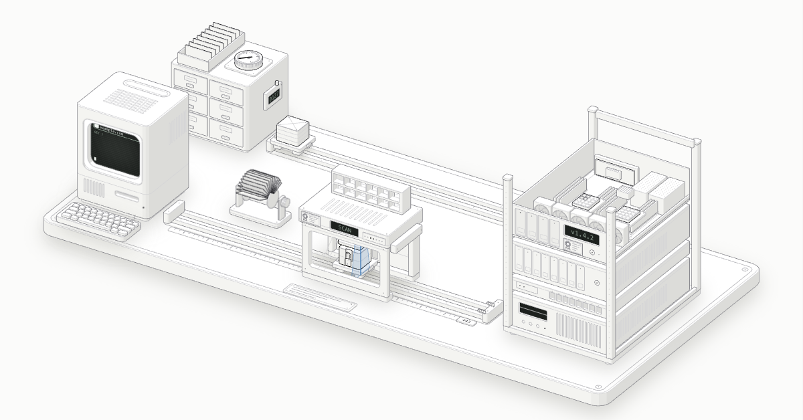

# Website Anatomy

An interactive diorama of how a small website is served and deployed: a VDS behind Cloudflare, encrypted with SSL/TLS, deployed from GitHub.

**Live:** https://rahmangungor.github.io/website-anatomy/

## What this is

- A simplified, interactive model of how a small website on a VDS is served through Cloudflare and deployed from GitHub.
- A way to see where DNS, TLS, the WAF, the cache and the deploy pipeline sit in a single request's journey.
- One HTML file with SVG and JavaScript. No framework, no build step to view it, no tracking.

## What this isn't

- A network simulator. No packets are sent and the timings are representative.
- A reference architecture or a security checklist. Real setups vary a lot.
- Affiliated with Cloudflare or GitHub.

## What you are looking at

| In the model | What it stands for |
| --- | --- |
| Terminal on the left | A visitor's browser |
| Rotary card file | DNS: `example.com` resolves to a Cloudflare IP, so the server's real IP stays hidden |
| Padlock on the carrier box | TLS encryption: locked in the browser, opened at Cloudflare, locked again on the way to the server |
| X-ray tunnel | Cloudflare's edge: decrypts the request and scans it with the WAF; the roller shutter is a `403` |
| Shelf on the tunnel roof | Cloudflare's cache: a `HIT` is answered here, a `MISS` goes on to the server |
| Server rack | The VDS: one physical server split into virtual machines; the four glowing cores are yours |
| Card cabinet and back rail | The GitHub repository and an Actions workflow that deploys over SSH |

## Try it

- **Send request** (`Space`): the first request is a `MISS` and goes all the way to the VDS. The next one is a `HIT` answered by Cloudflare.
- **Attack** (`A`): a SQL injection is stopped at Cloudflare with a `403` and never reaches the server.
- **Deploy** (`D`): push, build and test, copy to the VDS over SSH, new version live, cache purged.
- Click a station, or press `1` to `6`, to read what it does.

Left alone, the page plays a short tour of all of the above.

## Notes

- Timings are representative (`MISS` ≈ 150 ms, `HIT` ≈ 20 ms) and vary with location and hardware.
- Cloudflare only caches static files by default. Caching HTML, as shown here, needs a Cache Rule.
- The page follows your system's light or dark theme.

## Credits

Drawn with the [anatomy](https://github.com/wheresryan22/anatomy) isometric kit (MIT). See [NOTICE.md](NOTICE.md).
